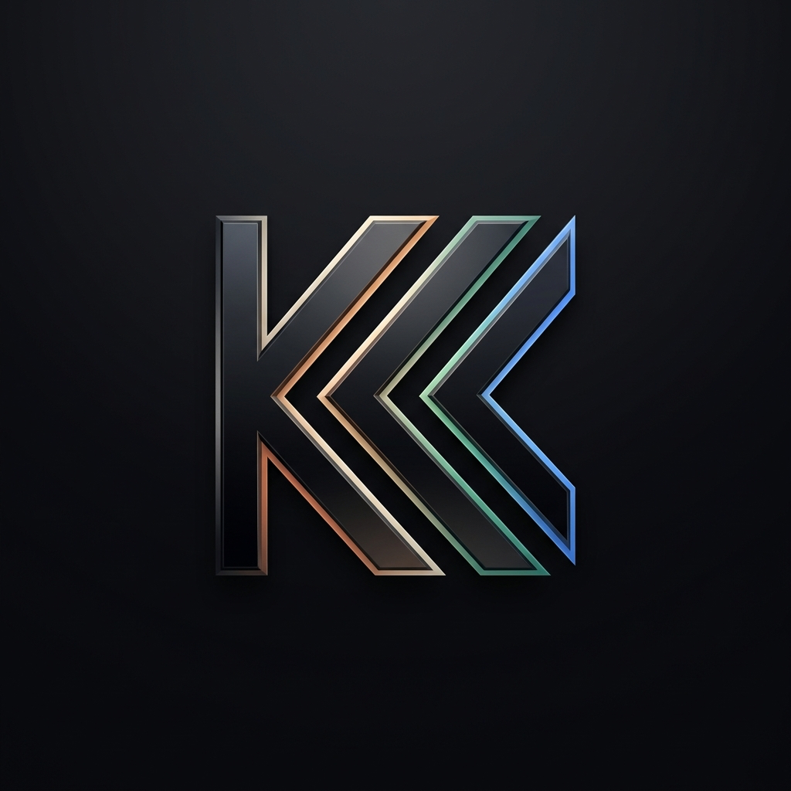

<p align="center">
  
</p>

<h1 align="center">Karv</h1>

<p align="center">
  <strong>Every AI subscription limit. One glance.</strong><br />
  Track your <strong>Claude</strong>, <strong>Codex</strong>, and <strong>Gemini</strong> rolling windows, pacing, and reset timers across iPhone, Home Screen widgets, and your Mac menu bar.
</p>

<p align="center">
  
  
  
  
</p>

---

### Why Karv?

Named after the traditional Swedish ***karvstock*** — a notched tally stick used for centuries to keep count of credits and allowances — **Karv** brings that same tactile clarity to modern AI subscriptions.

Stop opening three dashboards just to find out whether you're about to hit a 5-hour Claude cap or burn through your weekly limit mid-week.

### Highlights

- **Pacing Rings (`W` & `S`) Everywhere** — Compact circular rings for **Weekly (`W`)** and **Session / Daily (`S`)** usage with a live radial pace needle: **green** when you have healthy headroom, **red** when you're burning ahead of schedule.
- **Session + Weekly Side-by-Side** — Every subscription card on iPhone shows both your rolling session and weekly caps together, complete with live ticking reset countdowns and 7-day Swift Charts trends.
- **Home Screen, Lock Screen & Menu Bar** — Native Small, Medium, Large, and Lock Screen iOS widgets paired with a featherweight **`KarvMac`** menu bar companion rendering live `W` & `S` rings right in macOS.
- **Sync That Just Works**
  - **Direct Claude on 5G**: Store your Claude OAuth token in iOS Keychain to fetch live 5h & 7-day usage directly from Anthropic — even when your Mac is closed.
  - **Automatic iCloud & Bonjour Wi-Fi Sync**: `KarvMac` syncs local usage seamlessly over iCloud anywhere in the world, and instantaneously over local Wi-Fi (`_karv._tcp`).
- **Only What You Actually Use** — Uninstalled or disconnected platforms are automatically hidden from your dashboard, trends, and widgets.
- **Dark-First Minimalism** — Deep obsidian surfaces, hairline borders, subtle per-provider ambient glows, and crisp tabular numerals built natively in SwiftUI.

---

### Architecture

| Target | Platform | Purpose |
| :--- | :--- | :--- |
| **`KarvCore`** | Swift 6 Package | Shared models, countdown formatting, `ClaudeOAuthUsageClient`, `KarvKeychain`, and `KarvSyncStore` (iCloud KVS + App Group). |
| **`Karv`** | iOS 18+ | Native dark-first SwiftUI dashboard, provider detail sheets, 7-day Swift Charts, Bonjour client, and Direct Claude 5G sync. |
| **`KarvWidget`** | iOS WidgetKit | Small, Medium, Large, and Lock Screen `W` / `S` pacing-ring widgets synced via shared App Group. |
| **`KarvMac`** | macOS 15+ | Menu bar companion (`LSUIElement`) reading live Claude OAuth + local CLI activity (`~/.claude`, `~/.codex`, `~/.gemini`) and broadcasting over iCloud + Bonjour. |

---

### Quick Start

1. **Generate or open the Xcode project**
   ```bash
   xcodegen generate
   open Karv.xcodeproj
   ```
2. **Sign with your Apple Developer Team**
   Update `DEVELOPMENT_TEAM` and `bundleIdPrefix` in `project.yml` (or set your team under **Signing & Capabilities** in Xcode for `Karv`, `KarvWidget`, and `KarvMac`).
3. **Run `Karv` on your iPhone & `KarvMac` on your Mac**
   - Launch **`KarvMac`** to start live menu bar tracking and automatic iCloud + Wi-Fi syncing.
   - Launch **`Karv`** on iPhone, allow Local Network access (for instant Wi-Fi sync), or add your Claude OAuth token in **Sync → Direct Claude** for standalone 5G updates.
   - Long-press your Home Screen → **Add Widget** → search **Karv**.
